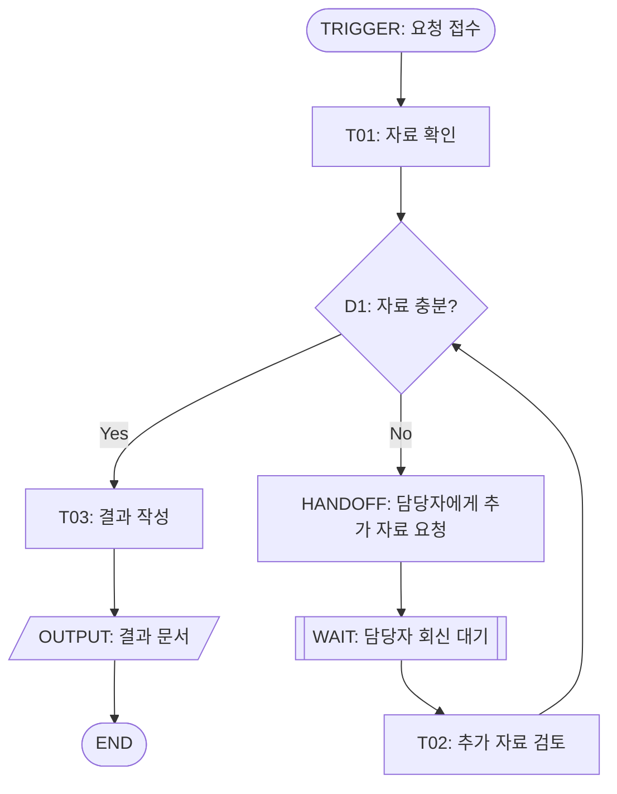
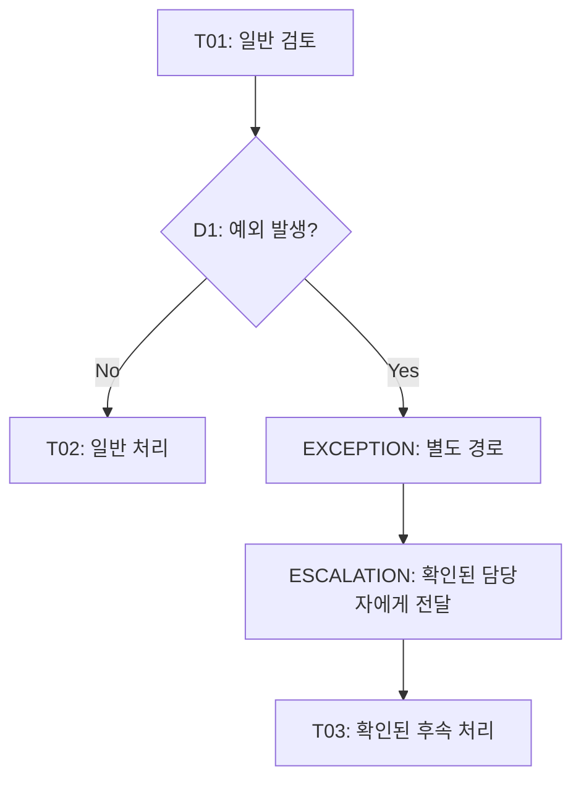

# Notation Guide

기본 표현은 Node Table과 Mermaid `flowchart`다. 업무가 복잡하면 Main Flow와 Exception Flow를 나누며, 하나의 거대한 Diagram에 모든 설명을 욱여넣지 않는다.

## 1. Node Type 표기

Mermaid Node ID는 공백 없는 안정적인 Map ID (`N01`, `D01`, `W01` 등)를 쓴다. Label에는 원 Task ID를 포함해 추적 가능하게 한다.

| Type | 권장 형태 | 예 |
|---|---|---|
| TRIGGER | 둥근 시작 Node | `N00([TRIGGER: 요청 접수])` |
| TASK | 사각형 | `N01[ TASK T01: 자료 확인 ]` |
| DECISION | 마름모 | `D01{D1: 추가 검토 필요?}` |
| HANDOFF | 전달 주체가 보이는 사각형 | `H01[HANDOFF: 담당자에게 전달]` |
| WAIT | 대기 상태가 보이는 Node | `W01[[WAIT: 회신 대기]]` |
| LOOP | Loop Edge로 표시 | `N03 -->|수정 요청| N02` |
| EXCEPTION | 별도 subgraph 또는 명시적 Node | `E01[EXCEPTION: 긴급 경로]` |
| ESCALATION | 대상/전달이 확인된 Node | `X01[ESCALATION: 팀장 검토 요청]` |
| OUTPUT | 결과물 Node | `O01[/OUTPUT: 검토 결과/]` |
| END | 종료 Node | `Z01([END])` |

Node 문법의 공백은 예시처럼 label 안에 포함할 수 있다. Mermaid의 예약 문구, 따옴표, 괄호 등 파서 충돌 가능성이 있는 문자는 단순한 label로 바꾼다. 의미는 바꾸지 않는다.

## 2. Branch, Wait, Loop 예시

이 예시는 표현법만 설명한다. 실제 Map에서 Yes/No, 담당자, Loop 종료 조건은 입력 또는 사용자 확인이 있을 때만 쓴다.

## 3. Exception Flow 예시

Exception이 별도의 의미 있는 흐름을 만들지 않으면 간단한 주석/Node로만 표현한다. 정상 경로와 합류하는 위치가 불명확하면 임의로 연결하지 않고 확인한다.

## 4. Mermaid 품질 규칙

- 선언은 `flowchart TD` 또는 필요에 따라 `flowchart LR`로 시작한다.
- 모든 Mermaid ID는 고유해야 하며 Node Table의 `node_id`와 맞아야 한다.
- 모든 화살표의 from/to는 정의된 Node여야 한다.
- Branch label은 확인된 조건만 쓴다.
- 복수 Actor가 핵심인 경우 swimlane을 억지로 흉내 내지 않는다. Node의 `actor` 필드와 표로 책임을 명확히 한다.
- Table과 Diagram이 불일치하면 제출 전에 정정한다.
- Mermaid 렌더러에서 유효하지 않거나 읽기 어려운 복잡도라면 Diagram을 나누고 그 이유를 설명한다.